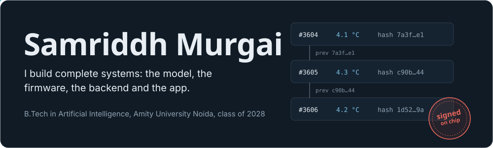
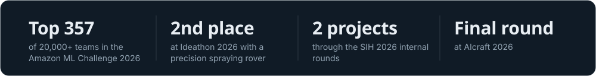
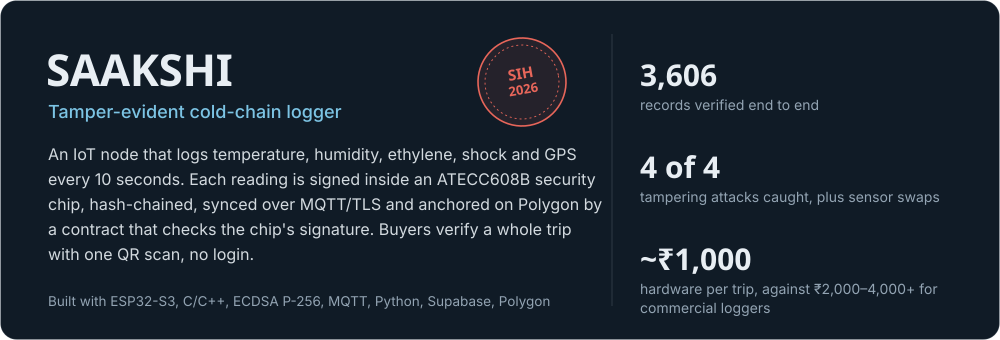
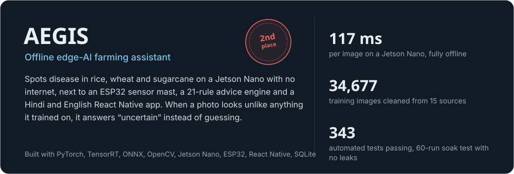
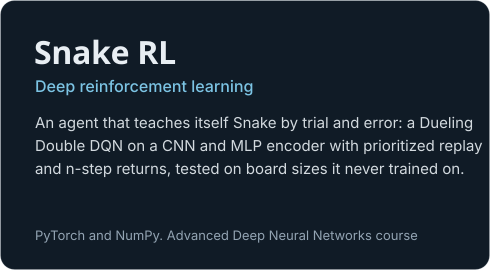
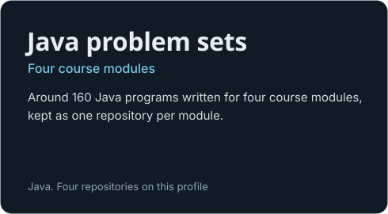
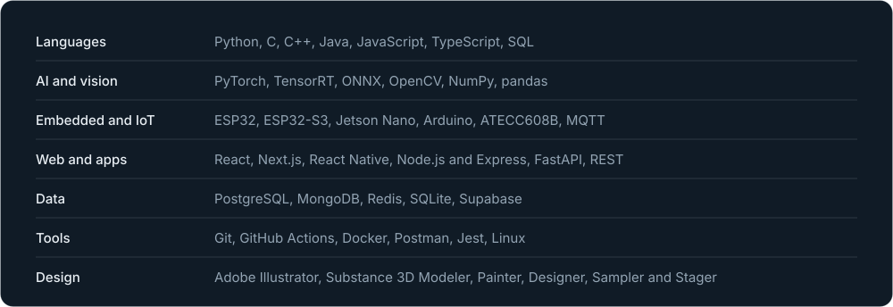

<picture><source media="(prefers-color-scheme: dark)" srcset="assets/header-dark.svg"><source media="(prefers-color-scheme: light)" srcset="assets/header-light.svg"></picture>

I like building things that have to work in the field, not just in a notebook: a crop-disease model that runs on a Jetson Nano with no internet, and a cold-chain logger whose records can't be quietly edited. I usually take a project end to end, from training the model and writing the firmware to the backend and the app people actually use.

Beyond projects, I'm a senior member of the HardlyHuman AI Club at Amity on the management and content team, and I was a Young Innovator intern at Hero MotoCorp in 2023.

<picture><source media="(prefers-color-scheme: dark)" srcset="assets/wins-dark.svg"><source media="(prefers-color-scheme: light)" srcset="assets/wins-light.svg"></picture>

### Projects

<a href="https://github.com/samxdevs/SAAKSHI_AEGIS_X"><picture><source media="(prefers-color-scheme: dark)" srcset="assets/card-saakshi-dark.svg"><source media="(prefers-color-scheme: light)" srcset="assets/card-saakshi-light.svg"></picture></a>

<a href="https://github.com/vitthalg17/Aegis-SIH"><picture><source media="(prefers-color-scheme: dark)" srcset="assets/card-aegis-dark.svg"><source media="(prefers-color-scheme: light)" srcset="assets/card-aegis-light.svg"></picture></a>

<a href="https://github.com/samriddhm/snake-rl-d3qn"><picture><source media="(prefers-color-scheme: dark)" srcset="assets/card-snake-dark.svg"><source media="(prefers-color-scheme: light)" srcset="assets/card-snake-light.svg"></picture></a>
<a href="https://github.com/samriddhm?tab=repositories"><picture><source media="(prefers-color-scheme: dark)" srcset="assets/card-java-dark.svg"><source media="(prefers-color-scheme: light)" srcset="assets/card-java-light.svg"></picture></a>

### Stack

<picture><source media="(prefers-color-scheme: dark)" srcset="assets/stack-dark.svg"><source media="(prefers-color-scheme: light)" srcset="assets/stack-light.svg"></picture>

### Get in touch

<a href="https://www.linkedin.com/in/samriddh-murgai"><picture><source media="(prefers-color-scheme: dark)" srcset="assets/link-linkedin-dark.svg"><source media="(prefers-color-scheme: light)" srcset="assets/link-linkedin-light.svg"></picture></a>
<a href="mailto:samriddhmurgai@gmail.com"><picture><source media="(prefers-color-scheme: dark)" srcset="assets/link-email-dark.svg"><source media="(prefers-color-scheme: light)" srcset="assets/link-email-light.svg"></picture></a>
